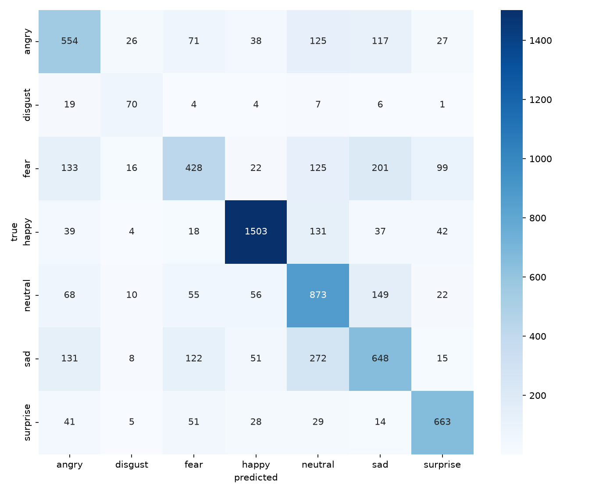
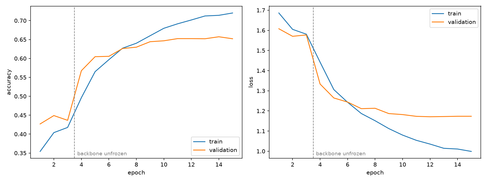

# Facial Expression Recognition on FER-2013

Three approaches to the same problem, evaluated on the same 7,178-image FER-2013 test set: hand-crafted features with a linear SVM, a CNN trained from scratch, and an ImageNet-pretrained EfficientNet-B0 fine-tuned on the faces.

| Approach | Parameters | Test accuracy | Macro F1 |
|---|---|---|---|
| Phase I: HOG + Gabor + MediaPipe landmarks → linear SVM | – | 52.2% | 0.46 |
| Phase II: custom CNN with class weighting and augmentation | 7.19M | 64.6% | 0.61 |
| Phase III: EfficientNet-B0 (ImageNet) fine-tuned, flip test-time augmentation | 4.06M | **66.0%** | **0.63** |

Without test-time flipping, Phase III scores 65.5%.

For context, human accuracy on FER-2013 was estimated at roughly 65% ± 5% when the dataset was released (Goodfellow et al., 2013). The images are 48×48 grayscale, and many labels are ambiguous even to people. The best published single networks reach about 73% (Khaireddin & Chen, 2021).

## Phase III results

| Emotion | Precision | Recall | F1 | F1 in Phase II | Test images |
|---|---|---|---|---|---|
| angry | 0.562 | 0.578 | 0.570 | 0.571 | 958 |
| disgust | 0.504 | 0.631 | 0.560 | 0.500 | 111 |
| fear | 0.571 | 0.418 | **0.483** | 0.375 | 1,024 |
| happy | 0.883 | 0.847 | 0.865 | 0.863 | 1,774 |
| neutral | 0.559 | 0.708 | 0.625 | 0.618 | 1,233 |
| sad | 0.553 | 0.520 | 0.536 | 0.546 | 1,247 |
| surprise | 0.763 | 0.798 | 0.780 | 0.764 | 831 |





Full metrics, the confusion matrix and the training history are in [`results/efficientnet_b0_metrics.json`](results/efficientnet_b0_metrics.json).

### What changed, and what didn't

- **Frozen ImageNet features are not enough.** With the backbone frozen, validation accuracy was 43–45% after three epochs of training the head. Features learned on color photos of objects are not tuned to small changes around the eyes and mouth. The gain came after the backbone was unfrozen and fine-tuned (the dashed line in the curves).
- **Fear improved the most.** Recall rose from 0.29 to 0.42 (301 → 428 correct). Fear → surprise errors fell from 142 to 99, and fear → angry from 151 to 133. Fear is still the weakest class, and 201 fear faces are still read as sad.
- **Disgust became more precise.** Precision rose from 0.39 to 0.50. Phase II used fully balanced class weights (9.4× for disgust). Phase III uses their square root, which trades a little disgust recall (0.69 → 0.63) for fewer false disgust predictions.
- **Sad and neutral are now the largest confusion.** 272 sad faces are predicted as neutral, up from 198. Neutral recall rose (0.64 → 0.71) while sad recall fell (0.57 → 0.52), so part of the gain on neutral is borrowed from sad.
- **Happy and surprise stay the easy ones** (F1 0.87 and 0.78).

## Phase II results

| Emotion | Precision | Recall | F1 | Test images |
|---|---|---|---|---|
| angry | 0.553 | 0.590 | 0.571 | 958 |
| disgust | 0.391 | 0.694 | 0.500 | 111 |
| fear | 0.519 | 0.294 | 0.375 | 1,024 |
| happy | 0.886 | 0.842 | 0.863 | 1,774 |
| neutral | 0.594 | 0.643 | 0.618 | 1,233 |
| sad | 0.522 | 0.572 | 0.546 | 1,247 |
| surprise | 0.702 | 0.838 | 0.764 | 831 |

Confusion matrices for comparison: [Phase II](assets/confusion_matrix_cnn.png), [Phase I](assets/confusion_matrix_svm.png). Phase II training curves: [assets/training_curves_cnn.png](assets/training_curves_cnn.png).

## How each phase works

**Phase I** ([notebook](notebooks/01_classical_hog_gabor_landmarks_svm.ipynb)): Haar-cascade face crop, MediaPipe eye-based alignment, then three feature families concatenated: HOG descriptors, mean and variance of a 32-filter Gabor bank, and the 468 MediaPipe face-mesh landmark coordinates. A `LinearSVC` classifies the result.

**Phase II** ([notebook](notebooks/02_custom_cnn.ipynb), code in [`src/fer/model.py`](src/fer/model.py)):

- Four convolutional blocks (64, 128, 256, 512 filters), each two Conv-BatchNorm-ReLU layers, max pooling and 25% dropout
- Two dense layers (512, 256) with batch norm and 50% dropout, then a 7-way softmax; 7.19M parameters
- Adam at 1e-3, batch 64, up to 50 epochs, early stopping on validation loss (patience 10), learning rate halved on plateau (patience 5)
- Augmentation: rotation up to 20°, 20% shifts, 20% zoom, horizontal flips
- Balanced class weights, stratified 80/20 train/validation split of the training set

**Phase III** ([`src/fer/transfer.py`](src/fer/transfer.py), [`train_transfer.py`](train_transfer.py)):

- Inside the model, each 48×48 face is upscaled to 96×96 and copied to three channels, so it takes exactly the same input arrays as the CNN
- EfficientNet-B0 with ImageNet weights, global average pooling, 30% dropout and a 7-way softmax; 4.06M parameters
- Stage 1: backbone frozen, head trained for 3 epochs at 1e-3
- Stage 2: backbone unfrozen except batch normalization (its ImageNet statistics are kept), 12 epochs with a cosine-decaying learning rate from 1e-4, best epoch kept on validation accuracy
- Label smoothing 0.1; square-root class weights; flip, small rotation, shift and zoom augmentation inside the model
- At test time, each face and its mirror image are predicted and the two probability vectors averaged
- Same stratified 80/20 train/validation split; the test set is used once, at the end
- Trained on a laptop CPU in about 40 minutes

## Run it

```bash
pip install -e ".[dev]"
pytest

# FER-2013 in folder form: data/fer2013/{train,test}/{angry,disgust,fear,happy,neutral,sad,surprise}/
python train.py          --data-dir data/fer2013                          # Phase II
python train_transfer.py --data-dir data/fer2013 --out-dir models/transfer  # Phase III
python evaluate.py --model models/transfer/efficientnet_b0_fer.keras --data-dir data/fer2013
python predict.py  --model models/transfer/efficientnet_b0_fer.keras photo.jpg
```

`train_transfer.py` downloads the ImageNet weights on first use and writes `metrics.json` (with and without test-time flipping) next to the model. `evaluate.py` and `predict.py` work with either model. `predict.py` crops the largest face before predicting, since both models only ever saw tightly cropped faces. Pass `--cropped` for images that are already face crops, such as the FER-2013 test images. `evaluate.py` writes `metrics.json` and a confusion matrix to `reports/` (without test-time flipping).

The dataset is not included. It is the folder version of FER-2013 on Kaggle (`msambare/fer2013`), with 28,709 training and 7,178 test images.

The Phase II numbers come from the notebook run on a Colab T4 GPU. The scripts reproduce the same architecture and training setup, so a fresh run lands close to them but not exactly on them (random initialization and augmentation). The Phase III numbers come from `train_transfer.py` with its default settings and seed.

## Repository layout

```
notebooks/          the two original notebooks, with outputs
src/fer/            data loading, CNN, transfer model, face cropping
train.py            Phase II training with the notebook's callbacks and augmentation
train_transfer.py   Phase III two-stage fine-tuning
evaluate.py         metrics.json + confusion matrix for any saved model
predict.py          face crop + top-3 emotions for any photo
results/            Phase III metrics and training history
tests/              model shapes, parameter count, loader, class weights, flip averaging, face-crop fallback
assets/             figures used in this README
```

## Limitations and next steps

- Fear and sad remain hard, and sad ↔ neutral is the largest confusion. FER+, a relabeled version of FER-2013 with ten annotators per image, would show how much of the remaining error is label noise.
- Phase III runs at 96×96 to keep CPU training under an hour. Higher input resolution, larger backbones and ensembles are the usual next steps.
- No face alignment is applied before the CNN or EfficientNet. Phase I's MediaPipe alignment could be added in front of either.

## Credits

Built as a group project for the Computer Vision course at Al-Ahliyya Amman University, Fall 2025/26. Phase III was added afterwards.
